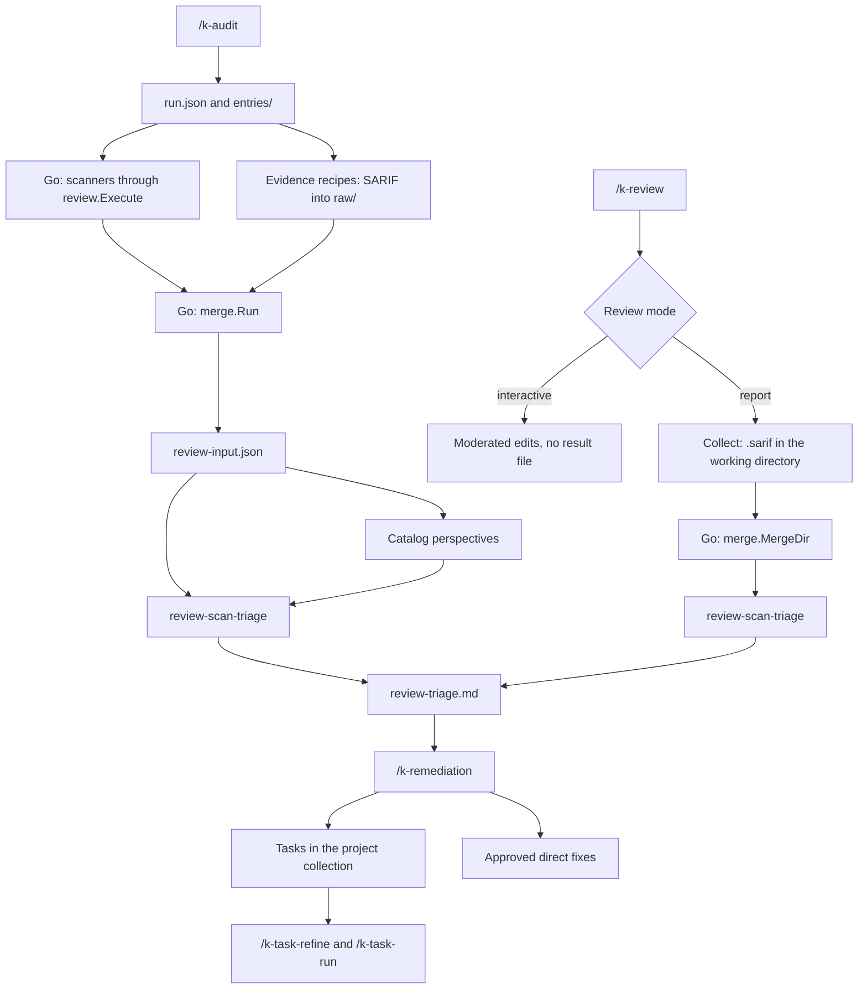

# Code Review Flow

This page describes how a review runs in k-playbook: the two paths that lead into it, the
artifacts they create, the recipe families, and the handoff to `/k-remediation`.

Both paths end in the same artifact, `review-triage.md`: a checklist with one row per bundle,
sorted by priority, with a "done" column, and every finding in detail below. For `/k-review`
that holds for report recipes; an interactive run moderates edits and creates no result file.
What differs is state, tooling, and scope.

**`/k-review` runs again (task 197); the rest is still paused.** `/k-review` is built from two
building blocks — collect (a recipe writes its findings as a SARIF finding list into a working
directory) and summarize (the Go merge writes `review-input.json`, the triage writes
`review-triage.md`) — and keeps its results only in that working directory, by default a new
directory under `/tmp/` that only the own user can read. It uses two MCP tools that create no
audit run and are not locked: `k_playbook_review_workdir` and `k_playbook_review_merge_dir`
(CLI `k-playbook review workdir|merge`). Still locked (task 147), because the storage of audit
results is being rebuilt: `/k-audit` and `/k-remediation` only say that they are temporarily
unavailable, `k-playbook scan` and `k-playbook merge` end with an error, and the five MCP tools
`k_playbook_review_status`, `_create`, `_scan`, `_merge` and `_write_ai_entry` answer
`reviews_paused`, read nothing and write nothing
([`mcp.md`](./mcp.md#review-tools-are-paused)). The interface shows the message of the lock
instead of runs. Where this page describes the audit path, it describes the code behind the
lock; `<ergebnisort>` stands for the location of audit results, which is not decided yet.

**Which page owns what.** So that the boundary does not slip again: this page describes both
paths, the family flow, and the family artifacts. [`review-runs.md`](./review-runs.md) describes
the inside of a run — `run.json`, `entries/`, states, merge. [`mcp.md`](./mcp.md) describes the
tool contract of the MCP server. Content that belongs on one of the other pages is linked from
here instead of repeated.

## The Two Paths

| | `/k-audit` | `/k-review <name> [working directory]` |
|---|---|---|
| State | `run.json`, `entries/`, resumable | none |
| MCP | yes, five tools (paused) | two tools: `k_playbook_review_workdir`, `k_playbook_review_merge_dir` |
| Scanners | Go, through `review.Execute` | none |
| `review-input.json` | Go, through `merge.Run` | Go, through `merge.MergeDir` on the working directory |
| Consolidation across sources | yes | no — one recipe, one finding list |
| known decisions | matched by the merge | not matched; the result says so in one sentence |
| Location | `<ergebnisort>/YYYY-MM-DD/` | the working directory: given, or new under `/tmp/` (`0700`) |

`/k-audit` drives its whole run through the five `k_playbook_review_*` run tools. `/k-review`
starts no scanner and holds no run state; it only lets the program create the working directory
and run the merge on it.

## Division of Labour



- Go owns the scanners. `k_playbook_review_scan` does not shell out to the CLI; it calls
  `review.Execute`. MCP inputs contain no shell commands, and the assistant never starts a
  scanner itself.
- Go owns consolidation: deduplication, stable group IDs, and coverage from `known-decisions.md`.
- The assistant owns the judgements: evidence recipes, perspectives, triage, priority, and
  category.
- The state lives on disk, not in the chat. That is what makes `/k-audit` resumable.
- The interface creates no run. Its `GET /api/reviews` lists none either: it answers with the
  message of the lock.

Consolidation across sources happens at **one** point: in the audit run. The merge deduplicates across tools,
records coverage from `known-decisions.md`, and the triage assigns priority and category. No
downstream step repeats the same work at a higher level.

## /k-audit

`/k-audit` is the chat entry point for the complete scan-and-assessment sweep. It holds no state
of its own: every invocation reads the actual state from the run directory through the MCP tools
and continues exactly there. The nine steps:

1. Determine paths and run — a new run, `latest`, or a given date.
2. Read the status through `k_playbook_review_status`.
3. Clarify the selection for a new run and create it through `k_playbook_review_create`.
4. Start the scanners through `k_playbook_review_scan`; Go executes the tool entries.
5. Run the evidence recipes, **before** the merge. They do not read `review-input.json`; they
   supply a part of it as `raw/<entry>.sarif`.
6. Start the merge through `k_playbook_review_merge`; Go writes `review-input.json` and
   `review-input.md`.
7. Run the catalog perspectives, only once `review-input.json` exists in the run directory.
8. Write the assessment with `review-scan-triage` into `review-triage.md`.
9. Close out and hand off: read the status again, report run, entry states, and artifacts, and
   name the next command.

Details of the run itself — `run.json`, `entries/`, entry states, repair, and the merge — are in
[`review-runs.md`](./review-runs.md). The tool contract is in [`mcp.md`](./mcp.md#tools).

## /k-review

`/k-review` runs a single review recipe against the current project. The command is the entry
point for structured reviews outside a specific GitHub PR. It is a thin wrapper over the text
`k-playbook:/commands/k-review.md`.

Invocations:

```text
/k-review
/k-review code
/k-review tech /tmp/mein-review
```

The first argument is the recipe, the second an optional working directory (relative paths
count from the project root). Without an argument, the command offers the recipes from
`documents.reviews` of the briefing — shipped (`<hub>:k-playbook/defaults/reviews/`) and
project-owned (`keph:/k-playbook/reviews/`), already resolved against each other — that are
enabled for `/k-review` (`review.enabled`, default `true`). It reads the modes from the
frontmatter of each recipe:

- **Report** (`handoff` is set): the recipe must carry an evidence contract — `audit.mode:
  evidence`, `audit.ruleIds`, `audit.scope.paths`. Today that is `review-code` and
  `review-tech`.
- **Interactive** (no `handoff`): today `review-python-comment-hardspots`.

Not selectable through `/k-review`: the four perspective recipes (`review-sast`,
`review-secret-scanning`, `review-dependency-cve`, `review-iac-container`), which assess scanner
evidence of an audit run and collect nothing themselves, and `review-dependabot-alerts`, which
cannot write an evidence SARIF yet. All five carry `review.enabled: false`.

Interactive reviews moderate one location at a time:

- Search for candidates.
- Show a compact finding list.
- Collect questions for unclear points.
- Show a proposal for each location and wait for approval.
- Apply only confirmed changes.

A report review runs three steps:

1. **Working directory.** `k_playbook_review_workdir` takes the given path or creates a new
   directory directly under `/tmp/` (`$TMPDIR` is ignored) through `os.MkdirTemp`: project, recipe
   and timestamp in the name plus a random part, mode `0700`, no intermediate directory another
   user could have created first. A path inside the project triggers a warning: later scanner
   runs would read it.
2. **Collect** (`k-playbook:/commands/_review-run/erheben.md`). The recipe writes its findings
   as `<recipe>.sarif` into the working directory, in the same result form as in the audit run,
   and checks it with `k_playbook_review_merge_dir` and `check: true`: tool name equals the
   recipe key, every rule ID from `audit.ruleIds`, findings outside `audit.scope.paths` are
   dropped and counted. Collecting never summarizes.
3. **Summarize** (`k-playbook:/commands/_review-run/zusammenfassen.md`).
   `k_playbook_review_merge_dir` writes `review-input.json` and `review-input.md` (mode `0600`)
   with the same dedupe, stable group IDs and severity as the audit merge, without known
   decisions; then the triage module writes `review-triage.md`.

The working directory afterwards holds:

```text
<working directory>/<recipe>.sarif
<working directory>/review-input.json
<working directory>/review-input.md
<working directory>/review-triage.md
```

`review-triage.md` is self-contained: a header (recipe, scope, date, working directory), a
table with one row per bundle sorted `P1` → `P3` with a "done" column, then per bundle its
reasoning, next step and every finding with location, rule ID, level and message, and a residual
section for groups in no bundle. Nobody needs to read the JSON. The format is defined in
`k-playbook:/commands/_audit/review-scan-triage.md`; the evidence contract in
`k-playbook:/commands/_review-run/review-input-contract.md`.

`/k-review` keeps no log and no due date, reads no `known-decisions.md`, and writes nothing to
Kephalaion. A `/k-review` run consolidates nothing across sources; its working directory sits
outside every audit run. There is no follow-up command yet: `/k-remediation` still reads only
the old triage format.

## /k-remediation

`/k-remediation` works through findings from review results in a structured way. It does not
aggregate on its own: it takes exactly one result file and bundles its findings before
implementation.

Invocations:

```text
/k-remediation
/k-remediation <ergebnisort>/<date>/review-triage.md
/k-remediation <ergebnisort>/<family>/<date>/review-triage.md
```

Supported inputs:

- Audit runs such as `<ergebnisort>/<date>/review-triage.md`: the primary path.
- Result families such as `<ergebnisort>/<family>/<date>/review-triage.md`.
- Legacy: existing `<ergebnisort>/summary-YYYY-MM-DD.md` from the time when a
  downstream prioritization step still existed. They are read and processed, but nothing creates
  them any longer.
- Legacy: directories with `assessment.md` and `findings.md`, only when `review-triage.md` is
  absent.

The command accepts exactly **one** result file. It does not add a second source or deduplicate
against other runs; anyone needing consolidation brings their evidence into the audit run.

The command:

- loads open findings.
- considers `known-decisions.md`.
- bundles findings by risk, effort, coupling, quick-win potential, and shared verification.
- shows the remediation policy from `K-PLAYBOOK.yaml`.
- turns confirmed bundles into tasks or approved direct fixes.
- compares findings with the existing tasks in `keph:/user/<user>/tasks/` before creating tasks:
  source plus bundle/group ID must match. A match in an open task prevents a second task; a match
  under `done/` is reported but does not close the finding.
- maintains statuses and task references traceably in `review-triage.md`; for legacy inputs,
  continues to do so in the summary or `findings.md`.

`raw/` and run metadata remain read-only. They are auditable evidence and must not be rewritten.

The project-wide policy sits in the `remediation:` block of `K-PLAYBOOK.yaml`; its fields, the
modes, and what applies when the block is absent are specified in
[`k-playbook-format.md`](./k-playbook-format.md#remediation).

The result path in a task is a **provenance statement, not a resolvable reference**: a task
outlives the result file it names. Whoever reads the task later does not necessarily have that
file, and even on the machine that created it, it is overwritten by the next run.
Inline evidence therefore remains required: group IDs, location, and message belong in the task
itself, not only in a reference.

## Scanner Tools

Security scanners such as `gitleaks`, `trufflehog`, `pip-audit`, `trivy`, `syft`, `grype`,
`semgrep`, `gosec`, `ruff`, and `njsscan` run through reviews, not as quick standalone
heuristics.

Reason:

- They create their own structured raw data such as JSON, SARIF-like reports, or SBOMs.
- Non-zero exit codes often mean substantive findings, not technical errors.
- Results must be deduplicated, prioritized, and assessed.
- Raw artifacts must reside in the run directory under `raw/`.
- Remediation needs stable finding IDs, status values, and source evidence.

These tools run only in the audit run, through `k_playbook_review_scan`; `/k-review` starts no
scanner. A perspective recipe assesses their evidence in the same run:

| Tool | Audit perspective |
|---|---|
| `gitleaks` | `review-secret-scanning` |
| `trufflehog` | `review-secret-scanning` |
| `pip-audit` | `review-dependency-cve` |
| `trivy` | `review-dependency-cve` and `review-iac-container` |
| `syft` | `review-iac-container` |
| `grype` | `review-dependency-cve` or `review-iac-container` |
| `semgrep` | `review-sast` |
| `gosec` | `review-sast` |
| `ruff` | `review-sast` |
| `njsscan` | `review-sast` |

GitHub Dependabot Alerts are not a tool entry; `review-dependabot-alerts` is not selectable for
now (see below).

## The Families in Detail

### Secret Scanning

| | |
|---|---|
| Recipe | `k-playbook:/reviews/review-secret-scanning.md` |
| `/k-review` | not selectable (`review.enabled: false`); audit only |
| Audit perspective | `<ergebnisort>/YYYY-MM-DD/review-secret-scanning.md` |
| Audit scope | `gitleaks`, `trufflehog` |

Typical raw artifacts in the audit run: `raw/gitleaks-*.json`,
`raw/trufflehog.json`.

The tools are provided locally on the host by
`~/.local/share/k-playbook/scripts/install-security-tools.sh`. Missing tools are not installed into the project.

### Dependency CVE

| | |
|---|---|
| Recipe | `k-playbook:/reviews/review-dependency-cve.md` |
| `/k-review` | not selectable (`review.enabled: false`); audit only |
| Audit perspective | `<ergebnisort>/YYYY-MM-DD/review-dependency-cve.md` |
| Audit scope | `pip-audit`, `trivy`, `grype`, `osv-scanner`, `govulncheck` |

Typical raw artifacts in the audit run: `raw/pip-audit.json`,
`raw/trivy-fs.json`, and, where needed, `raw/grype.json`.

This recipe is active in the audit run model. It assesses the groups from `review-input.json`
that carry at least one evidence item from an audit-scope tool.

### GitHub Dependabot Alerts

| | |
|---|---|
| Recipe | `k-playbook:/reviews/review-dependabot-alerts.md` |
| `/k-review` | not selectable for now (`review.enabled: false`, task 197) |
| Audit run model | disabled; rationale and examined alternatives are in the recipe |

The recipe has no way to its findings right now: the hand-written `review-input.json` of the old
report path is gone, and an evidence SARIF does not fit its source yet (todo 84). This family uses GitHub as its source. It is particularly suitable when a project does not use
local dependency scanners or first wants to assess the alert set present in GitHub. Intentionally
disabled Dependabot PRs, for example `open-pull-requests-limit: 0`, are not a finding.

### IaC/Container

| | |
|---|---|
| Recipe | `k-playbook:/reviews/review-iac-container.md` |
| `/k-review` | not selectable (`review.enabled: false`); audit only |
| Audit perspective | `<ergebnisort>/YYYY-MM-DD/review-iac-container.md` |
| Audit scope | `trivy`, `syft`, `grype` |

Typical raw artifacts in the audit run, for container, image, IaC, and filesystem findings:
`raw/trivy-*.json`, and, where needed, `raw/syft-*.json` and
`raw/grype-*.json`.

This recipe is active in the audit run model. It assesses the groups from `review-input.json`
that carry at least one evidence item from an audit-scope tool.

### SAST

| | |
|---|---|
| Recipe | `k-playbook:/reviews/review-sast.md` |
| `/k-review` | not selectable (`review.enabled: false`); audit only |
| Audit perspective | `<ergebnisort>/YYYY-MM-DD/review-sast.md` |
| Audit scope | `semgrep`, `gosec`, `ruff`, `njsscan` |

Typical raw artifacts in the audit run: `raw/semgrep.sarif`,
`raw/gosec.sarif`, `raw/ruff.sarif`, and `raw/njsscan.sarif`.

This recipe is active in the audit run model. It assesses the groups from `review-input.json`
that carry at least one evidence item from an audit-scope tool. It assesses patterns in the
project's own source code: findings about a version or a package belong to Dependency CVE,
secrets to Secret Scanning, and IaC or container configuration to IaC/Container.

### Tech Debt

| | |
|---|---|
| Recipe | `k-playbook:/reviews/review-tech.md` |
| `/k-review` | report; working directory with `tech.sarif` and `review-triage.md` |
| Audit entry | Evidence source `tech`, SARIF under `<ergebnisort>/YYYY-MM-DD/raw/tech.sarif` |

Through `/k-review` and in the audit run it writes the same SARIF finding list; only where it
lands differs. See also **Recipes as evidence sources** below.

### Code Review

| | |
|---|---|
| Recipe | `k-playbook:/reviews/review-code.md` |
| `/k-review` | report; working directory with `code.sarif` and `review-triage.md` |
| Audit entry | Evidence source `code`, SARIF under `<ergebnisort>/YYYY-MM-DD/raw/code.sarif` |
| Diff of a task | Section `## Ergebnisform für den Diff eines Tasks` in the recipe, for `/k-task-run` |

Through `/k-review` it writes `code.sarif` into the working directory. The recipe reviews
source code in Go, Python, shell, JavaScript, and TypeScript in four directions — correctness,
security, performance, and maintainability — with `code-*` rule IDs. It is tool-neutral and needs
no assistant-specific skill. Its criteria are the same in both result forms — the SARIF finding
list and the section for the diff of a task —; and in an audit run the recipe does not report again what another source of the same
run already covers: scanner entries in state `done` for their language and direction, and the
evidence entry `tech` when it is selected. It takes the entry states from the status output of
`/k-audit`. Run on its own, through `/k-review` or for the diff of a task, nothing is excluded.

For the diff of a task, subject, yardstick, and classification are defined in the recipe only; this
page does not repeat them. The use by `/k-task-run` has no switch
of its own: `review.enabled` only affects `/k-review` and `audit.enabled` only `/k-audit`; only an
empty project-owned `review-code.md` disables it. A project-owned overlay must carry the section
under the same heading.

### Recipes as Evidence Sources

Three catalog recipes provide their own evidence from code in a run rather than filtering existing
evidence. They run before the merge, read only their frozen `scope.paths`, and write SARIF to
`raw/<entry>.sarif`:

| Recipe | Entry | What it reads |
|---|---|---|
| `review-tech.md` | `tech` | Source and infrastructure files; tech-debt candidates with `tech-*` rule IDs. |
| `review-python-comment-hardspots.md` | `python-comment-hardspots` | Python sources; locations without reconstructable rationale, with `hardspot-*` rule IDs. |
| `review-code.md` | `code` | Source code in Go, Python, shell, JavaScript, and TypeScript; correctness, security, performance, and maintainability findings with `code-*` rule IDs. |

All three remain selectable through `/k-review`: `review-tech` and `review-code` as reports, which
write the same SARIF into the working directory instead of `raw/`, and
`review-python-comment-hardspots` interactively. The review criteria are the same on both paths.

### Recipes Outside Both Paths

| Recipe | Reason |
|---|---|
| `review-dependabot-alerts.md` | Input arrives externally through `gh api` — with a service of the personal access file through `k-playbook github run` (`defaults/commands/_shared/gh.md`) — and is not yet a tool entry in the run merge; its open advisory IDs fit no closed `audit.ruleIds` list. Disabled for `/k-audit` and, since task 197, for `/k-review`. |

The recipe contains its detailed examination itself: its **Position in the audit run model**
section states which part of the evidence contract blocks it and what a conversion would
require.

## Directories

Recipes and results are strictly separate:

```text
<hub>:k-playbook/defaults/reviews/     shipped recipes
keph:/k-playbook/reviews/              project-owned recipes, overlay (project collection)
<working directory>/                   everything one /k-review run creates
<ergebnisort>/                         everything an audit run creates (paused)
<ergebnisort>/known-decisions.md       deliberately made decisions, maintained by hand (audit)
```

`reviews/` contains only `review-<name>.md`. This keeps it a pure overlay directory, where every
file follows the same rule: same filename, the local file completely wins.

The working directory of `/k-review` is a parameter. Without it, the program creates
`/tmp/k-review-<project>-<recipe>-<timestamp>-<random>/` with mode `0700`; files the merge
writes get `0600`. Outside the project, later scanner runs do not read it. `/tmp/` does not
survive a restart everywhere (in WSL it does not); whoever wants to keep a result copies
`review-triage.md`. Keeping a result in Kephalaion on request is todo 78.

The audit layout behind the lock:

```text
<ergebnisort>/
├── known-decisions.md            deliberate decisions, maintained by hand
└── YYYY-MM-DD/                   an audit run: run.json, entries/, raw/, review-input.*, review-triage.md
```

### Results Are Not Project Knowledge

A review is repeatable from the code. Its result is a state from one machine at one point in
time, not project knowledge. That holds for everything a review writes, not only for raw scanner
output: `raw/` and `entries/`, finding lists `<recipe>.sarif`, generated documents
`review-input.md`, `review-input.json`, `run.json`, and `review-triage.md`, plus, where they
still exist, old `log.md` and `summary-YYYY-MM-DD.md` files.

Raw output from a secret scanner contains discovered secrets in clear text; it must never
enter the repository.

Whatever is genuinely project knowledge does not stay in a result: a deliberate decision is
written by hand into `known-decisions.md`, and remediation turns findings into tasks.

## Artifacts

- `<recipe>.sarif` (working directory) or `raw/<entry>.sarif` (audit run): the finding list of
  an evidence recipe. Scanners write their raw output under `raw/` of the audit run.
- `review-input.json` and `review-input.md`: the evidence contract and its compact view, always
  written by the Go merge — on the working directory by `k_playbook_review_merge_dir`, in the
  audit run by `k_playbook_review_merge`. The schema is specified in exactly one place:
  `k-playbook:/commands/_review-run/review-input-contract.md`. There is no hand-written
  `review-input.json` any more.
- `review-triage.md`: the result file, the same form for review and audit — a header, one table
  row per bundle sorted by priority with a "done" column, every finding in detail below, and a
  residual section, so that no finding drops out silently. Format:
  `k-playbook:/commands/_audit/review-scan-triage.md`.

Raw artifacts are auditable. They must not be shortened, overwritten, or corrected in content
after writing; the merge only removes findings outside the path scope of an evidence recipe and
says how many. Corrections are made through a new run.

Active audit catalog recipes contribute differently depending on `audit.mode`. A
**perspective** (`mode: perspective`) additionally writes one perspective file directly into the
run directory, for example `review-secret-scanning.md`; it reads the same merge evidence, filters
through its stored `scope.tools`, and serves only as context for `scan-triage`. An **evidence
source** (`mode: evidence`) writes no Markdown at all; it runs before the merge and stores
`raw/<entry>.sarif`, whose findings subsequently appear as groups with the `ai-<entry>-` prefix in
`review-input.json` and thus follow the same path as scanner findings.

`assessment.md`, `findings.md` and `summary-*.md` are legacy artifacts of older result families;
only the paused `/k-remediation` still reads them.

## Review Log

There is none any more. `/k-review` kept `log.md` with the last run and due date of each recipe
(`interval-weeks`); both are gone with task 197. `interval-weeks` stays in the recipes'
frontmatter until a central schedule takes it over.

## Status Model

The status table below is a **read path for legacy holdings**: those values belong to
`findings.md`, which new runs no longer write. It is listed here because `/k-remediation` still
reads such directories when no `review-triage.md` exists beside them. The rules that follow it —
ID stability and coverage from `known-decisions.md` — apply to the current
model as well.

| Status | Meaning | Relevant to remediation |
|---|---|---|
| `open` | new or not yet checked | yes |
| `confirmed` | validated real finding | yes |
| `context-needed` | further context review required | yes |
| `likely-false-positive` | plausible false positive | only after explicit selection |
| `accepted` | deliberate decision or accepted residual risk | no |
| `fixed` | fixed and verified | no |

Finding IDs must remain stable. IDs assigned once must not be renamed during re-runs, status
changes, or remediation.

Scanner families may retain their tool's native rule prefixes so a finding remains traceable to
its raw report.

Deliberate project-wide decisions are recorded in `<ergebnisort>/known-decisions.md` and
written by `k-playbook merge` as coverage on findings and groups. The format, location, and flow
rule are described in [`review-runs.md`](./review-runs.md#effect-of-known-decisionsmd). A decision
neither replaces a status value nor filters anything from raw data; it only makes visible that a
finding is covered by a documented decision.

## Handoff

A `/k-review` report names no follow-up command for now: `/k-remediation` reads the old triage
format (`## Bündel`, `## Bündel-Details`) and is paused. `/k-audit` closed with the run directory:

```text
/k-remediation <ergebnisort>/<YYYY-MM-DD>/review-triage.md
```

If `/k-remediation` creates tasks, the next step is not direct implementation in chat but the
normal task flow:

```text
/k-task-refine
/k-task-run
```

Created tasks should contain branch/PR notes when policy requires them. `/k-task-run` evaluates
the `## Execution context` section and runs branch and dirty-worktree preflights before
delegation.

## Scope

- `/k-audit` is the only place where findings from multiple sources are consolidated and
  deduplicated, and the only path that uses the five run tools of the MCP server.
- `/k-review` creates findings for one recipe and summarizes them, but does not directly
  implement larger remediation and consolidates nothing across sources.
- `/k-remediation` starts no scanners, accepts exactly one result file, and does not re-prioritize
  project-wide.
- Larger implementation proceeds through tasks, `/k-task-refine`, and `/k-task-run`.
- Direct fixes are allowed only with suitable policy and explicit approval.

## Security Tools

Project virtual environments are normal for project dependencies. Read-only status may measure an
active project virtual environment and labels that measurement context. Tool installation and
Docker fallbacks remain separate and local to the host/user; no project virtual environment may be
active before installation. Python CLI tools are recommended through `pipx` or, with
`--method venv`, in dedicated k-playbook tool virtual environments.

```bash
bash ~/.local/share/k-playbook/scripts/install-security-tools.sh                    # status
bash ~/.local/share/k-playbook/scripts/install-security-tools.sh --install missing  # asks before installation
bash ~/.local/share/k-playbook/scripts/install-security-tools.sh --install missing --method venv  # dedicated tool virtual environments
```

The required tools are canonically listed in
[`../share/scripts/security-tools.tsv`](../../../share/scripts/security-tools.tsv). The script, interface, and review
recipes read the same matrix.
