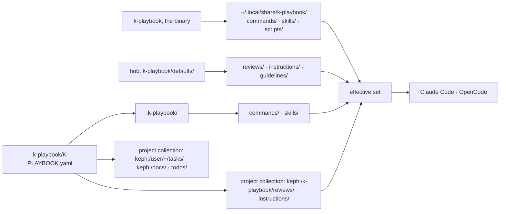
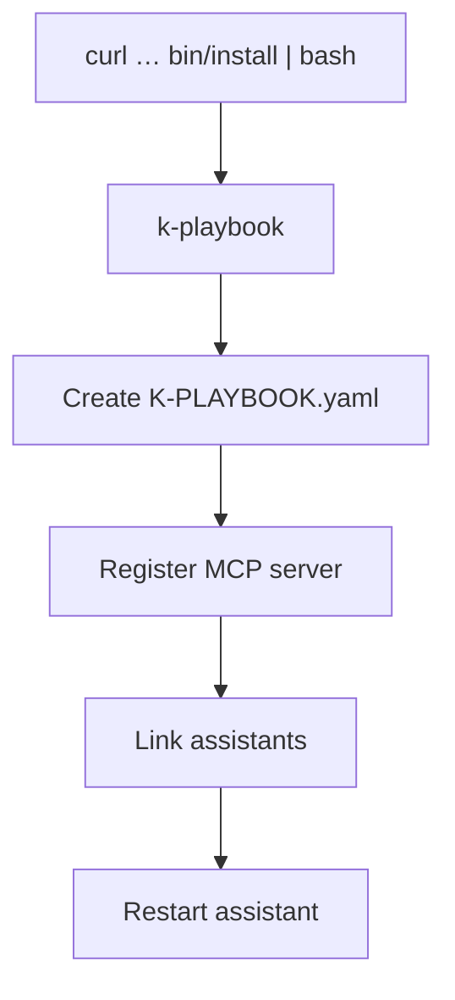
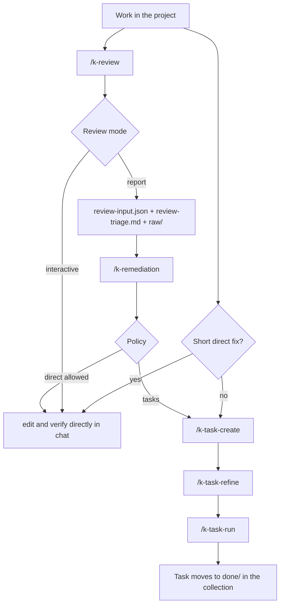

# Manual

This manual is the concise orientation for k-playbook. It describes the overall
model and normal sequence; detailed workflows are on the linked topic pages.

## Purpose

`k-playbook` is a toolkit for AI assistant work: slash commands, skills and review
recipes. It is installed as one binary per machine; a project carries only
its anchor and what it owns itself.

The goal is controlled, traceable, and repeatable assistant work:

- Keep shipped and project-owned content clearly separate.
- Update commands, skills and review recipes with the program: `k-playbook upgrade`
  brings the binary and what it unpacks, the hub brings the shipped texts.
- Store tasks, findings, and documentation in fixed locations.
- Make review, task, and remediation flows auditable.
- Establish docs as the first source for later AI sessions.

## Core model

What k-playbook ships and what a project owns never overlap, and only the second
lies in the project:

```text
project/
└── .k-playbook/
    ├── K-PLAYBOOK.yaml   the anchor; the directory holding .k-playbook/ is the project root
    ├── commands/         project-owned commands (only when used)
    └── skills/           project-owned skills (only when used)
```

| Part | Owner | What happens on update |
|---|---|---|
| `.k-playbook/K-PLAYBOOK.yaml`, `.k-playbook/commands/`, `.k-playbook/skills/` | the project | remains untouched |
| the project collection in Kephalaion: `keph:/k-playbook/`, `keph:/docs/`, `keph:/user/<user>/tasks/`, `todos/` | the project | remains untouched |
| the binary `~/.local/bin/k-playbook` and what it unpacks into `~/.local/share/k-playbook/` (commands, skills, scripts) | k-playbook | replaced by `k-playbook upgrade` or the update button |
| the shipped texts in `<hub>:k-playbook/defaults/` | k-playbook | the hub fetches the new release |

Because the installation is the binary alone, nothing shipped lies in the
project, and an update cannot touch anything the project owns. In the former
model the installation was a clone under `<project>/k-playbook/`; the program
neither reads nor pulls such a directory any more (task 156), and `/k-upgrade`
3.8 deletes an old clone.



### Paths are derived, not stored in config

There is no longer a `paths:` block. Every location is fixed: project-owned
commands and skills are under `.k-playbook/`, next to `K-PLAYBOOK.yaml`, and
project knowledge is under `keph:/docs/` in the project collection. Tasks are
documents in the project collection as well, `keph:/user/<user>/tasks/`, not
files on disk. The location of review results is not decided yet; reviews are
paused until then (task 147). A command therefore neither guesses nor reads a
path: it derives it, or it takes the reference.

The complete mapping is in [`k-playbook-format.md`](./k-playbook-format.md).

### Merge shipped and project-owned content

Three directories exist twice: `reviews/`, `commands/`, and `skills/`. What
applies is the union of both sides. **For the same name, the project-owned entry
wins, completely**: the shipped entry is not read at all. Checks no longer exist
(task 155), neither shipped nor project-owned.

Content is disabled with an **empty** local entry: nothing except blank lines
and comments. This lets the file record its own reason, without requiring a
list in the configuration.

For commands and skills, this determines how assistants are linked:
`.claude/commands` and the two other destinations are real directories with
**one symlink per entry**. A directory symlink points to exactly one source and
could never reach the second.

### One answer, not many

No command calculates what ultimately applies itself:

```bash
k-playbook context
```

The command outputs the resolved working state as JSON: directories,
remediation policy, and the
catalogs, already merged, including each entry's origin and marked
disabled entries. Guidelines are not part of it (task 148): they come shipped only,
and the briefing names them under `documents.guidelines`.

The same information is also available to an assistant as a tool:
`k-playbook mcp` starts an MCP server whose only tool returns the working state.
It is meant to be invoked by the assistant, not by hand; on the command line,
`context` remains the way to use it. Which MCP servers the project has
registered with each assistant -- this one and any other -- shows the interface
under *Setup → MCP-Server*, with a detail page per server that measures what
it offers on request; see [`mcp.md`](./mcp.md).

One answer also means once per session. The output does not change while work
is underway, so the next command does not retrieve it again but continues with
the existing result. Retrieve it again only after writing `K-PLAYBOOK.yaml`,
changing the set of reviews, or moving work to a
different project.

### Instructions at two levels

| Where | Applies to | On update |
|---|---|---|
| `<hub>:k-playbook/defaults/instructions/` | every project using k-playbook | the hub fetches the new release |
| `keph:/k-playbook/instructions/` in the project collection | this project only | remains |

Both levels reach a session through the briefing and through references
(`k-playbook:/instructions/…`); a project-owned document of the same name
replaces the shipped one, an empty one disables it. `AGENTS.md` in the project root receives
only a short prompt that names `k-playbook briefing`; existing content remains
untouched.

## Installation

```bash
curl -fsSL https://raw.githubusercontent.com/kascada/k-playbook/main/bin/install | bash
cd /path/to/project
k-playbook
```

Go is not required: `bin/install` is a shell script. It determines the newest
release tag, downloads the release asset of that tag for the current platform,
verifies it against the `SHA256SUMS` committed at the tag,
and installs it to `~/.local/bin/k-playbook`. If `kephalaion` is missing from the
`PATH`, it then installs it as well, through the `install.sh` of the latest
Kephalaion release. This one bootstrap runs once per host and once per DevContainer,
needs network access and `curl` or `wget` (no `git`), and `~/.local/bin` must be on
`PATH`. Nothing is copied into the project.
Afterwards the program updates itself from the release: the health check warns
when it is older than the newest published release (read from a cache under
`~/.cache/k-playbook/`, at most a few hours old), and `k-playbook upgrade` or the
update button of the interface install that release. The last command starts the
interface, which guides three steps: create configuration, register the MCP
server, and link assistants. Each write happens only after confirmation.



Details are in [`installation.md`](./installation.md).

## Important commands

The complete index is in [`commands.md`](./commands.md). The groups are:

| Group | Commands | Purpose |
|---|---|---|
| Project | `/k-gui` | Start the interface, check and set up project state |
| Docs | `/k-docs`, `/k-docs-code`, `/k-docs-tools`, `/k-doc-inventory` | Check and document project knowledge by origin in `keph:/docs/` |
| Code review | `/k-review`, `/k-audit`, `/k-remediation` | Run reviews and audits, address findings (temporarily unavailable while reviews are paused) |
| Task flow | `/k-task-create`, `/k-task-refine`, `/k-task-run`, `/k-todo` | Create, harden, and execute planned work |
| Utilities | `/k-enforcement`, `/k-test-check`, `/k-verlauf`, `/k-vscode-project-color` | Check docs follow-up (`/k-enforcement` temporarily unavailable), diagnose tests, read histories, mark VS Code |

New or changed commands become visible only after restarting the assistant.

## Workflows



### Task flow

For planned work that should not be completed in a short chat step:

```text
/k-task-create
/k-task-refine
/k-task-run
```

Tasks arise directly from the conversation or from `/k-remediation`. A task is a
document in the project collection under `keph:/user/<user>/tasks/`, completed
under `done/`; the briefing lists the own open ones under `work.tasks`, and the
form of a task stands once, in `k-playbook:/instructions/on-demand/tasks.md`.
Details are in [`task-flow.md`](./task-flow.md).

### Code review flow

Reviews are paused until the location of their results is decided; `/k-review`,
`/k-audit` and `/k-remediation` are temporarily unavailable. The flow itself:
report reviews produce auditable artifacts and lead to remediation when needed:

```text
/k-review <name>
/k-remediation <review-triage>
/k-task-refine
/k-task-run
```

There is no additional step between assessment and handling: `review-triage.md`
is both the result and the input for `/k-remediation`. To see multiple sources
merged, use `/k-audit`; findings are consolidated there, and only there.

The complete flow and the artifact model are in
[`code-review.md`](./code-review.md).

### Docs first

Project knowledge should be documented in the project collection. The
workflow follows the origins of the docs; each tool writes exclusively to
directories of its own origin:

```text
/k-docs           → check inventory and offer possible docs actions
/k-docs-code      → keph:/docs/generated/code/ (project collection, through k-playbook docs checkout|publish code)
/k-docs-tools     → keph:/docs/generated/libs/ (project collection, through k-playbook docs checkout|publish libs)
/k-doc-inventory  → keph:/docs/generated/versions/inventory.md (project collection)
```

The entry of the project documentation is `keph:/docs/` in the project's collection
(task 101): the briefing names it under `Projektdoku`, and a session reads it with
Kephalaion `list` on `docs/` (`recursive`, `frontmatter`) until Kephalaion generates
`docs/index.md`. Hand-written documentation lives under `keph:/docs/manual/`; a session
changes a page in place with `k_playbook_doc_replace` and `k_playbook_doc_append` (with
`since_revision`), not by rewriting it with Kephalaion `write`. There is
no fallback to the disk.

`/k-docs-code` and the skill `ks-overlay-repo-analyse` share
`keph:/docs/generated/code/` (task 109): `k-playbook docs checkout code` fetches the
directory into `.k-playbook/work/docs/code/`, the session writes the documents there, and
`k-playbook docs publish code` reconciles -- a document changed in Kephalaion since the
checkout is reported as a conflict, not overwritten, and the hand-maintained `hints` in each
document's frontmatter change only after the user confirms. Each writer changes only its own
documents (`generated.by`); the directory's `README.md` is written by `publish`.

`/k-docs` is the guided entry point: it checks inventory, consistency, and
session memory and offers the possible next step. The three producers create
content: `/k-docs-code` reads code, `/k-docs-tools` reads libraries, and
`/k-doc-inventory` reads declared versions from manifests, lockfiles, container,
Helm, and CI files. Skip a stage if it has no input. Raw material has no inbox of its
own (task 123); full-text search over `keph:/docs/` is Kephalaion's.

Each subdirectory of `docs/` represents an origin; a file's frontmatter records
which tool wrote it under `generated.by`. No command writes doc files in
`keph:/docs/manual/`; other documentation maintained by a project also remains
untouched. k-playbook claims only its own directory.

## Docs follow-up

The always-instruction "Doku nachziehen" makes every session update the hand-written
documentation, `README.md` and `AGENTS.md` in the same pass as a code change, before it
finishes the change. `/k-enforcement` is the explicit report on the docs follow-up for the
changed files of the working tree; it is temporarily unavailable while it is rebuilt without
checks (task 155). After a code
change the generated documentation is not regenerated on the spot: the session queues a
documentation order in `keph:/queue/docs/`
(`k-playbook:/instructions/on-demand/doku-auftraege.md`), which `/k-docs-code` or
`/k-docs-tools` works off in one run; `/k-docs` shows the open orders.

## Operating rules

- The installation is the binary alone, one per machine. A project carries no copy of the tool.
- What k-playbook ships is replaced by an update; nothing the project owns is touched by one.
- Do not edit shipped reviews. A project diverges from a review through an overlay: a same-named local file replaces it, and an empty one disables it.
- Paths are derived, not guessed or configured.
- `K-PLAYBOOK.yaml` is configuration, not documentation. An existing file is never overwritten.
- Projects may use their own venvs; security tools run separately, host/user-local or in dedicated k-playbook tool venvs.
- Review raw data and run metadata are auditable and are not silently overwritten.
- Larger remediation proceeds through tasks if project policy requires it.
- Restart the assistant after changing commands or skills.

## Further docs

| Topic | Document |
|---|---|
| Start page | [`overview.md`](./overview.md) |
| Installation | [`installation.md`](./installation.md) |
| Commands | [`commands.md`](./commands.md) |
| Project configuration | [`k-playbook-format.md`](./k-playbook-format.md) |
| Code review flow | [`code-review.md`](./code-review.md) |
| Task flow | [`task-flow.md`](./task-flow.md) |
| FAQ | [`faq.md`](./faq.md) |
