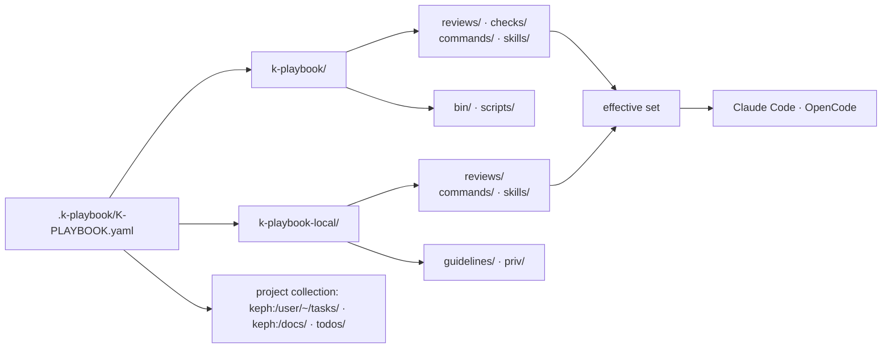
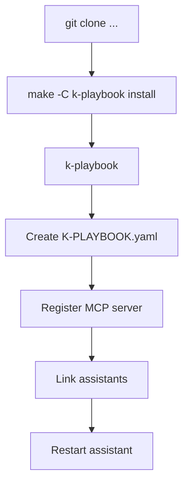
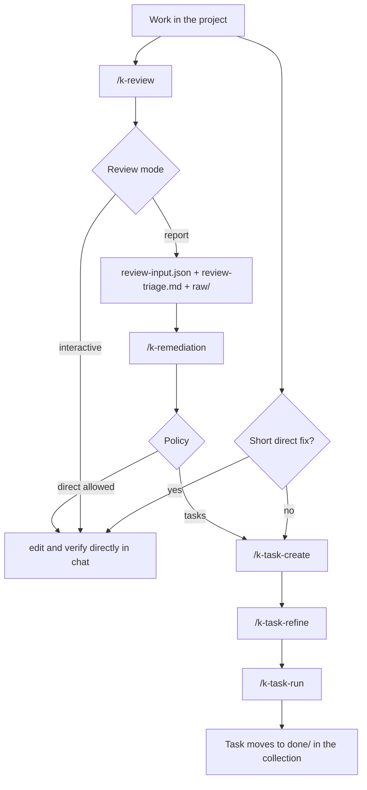

# Manual

This manual is the concise orientation for k-playbook. It describes the overall
model and normal sequence; detailed workflows are on the linked topic pages.

## Purpose

`k-playbook` is a toolkit for AI assistant work: slash commands, skills, review
recipes, and checks. It is cloned into a subdirectory of the project it
supports and sits alongside the project-owned artifacts.

The goal is controlled, traceable, and repeatable assistant work:

- Keep shipped and project-owned content clearly separate.
- Update commands, skills, review recipes, and checks using `git pull`.
- Store tasks, reviews, and results in fixed locations.
- Make review, task, and remediation flows auditable.
- Establish docs as the first source for later AI sessions.

## Core model

A project consists of three parts that never overlap:

```text
project/
├── .k-playbook/
│   └── K-PLAYBOOK.yaml   the anchor; the directory holding .k-playbook/ is the project root
├── k-playbook/           the installation, fully replaceable
└── k-playbook-local/     project-owned, committed
```

| Part | Owner | What happens on update |
|---|---|---|
| `.k-playbook/K-PLAYBOOK.yaml` | the project | remains untouched |
| `k-playbook/` | k-playbook | is fully replaced |
| `k-playbook-local/` | the project | remains untouched |

Because configuration is **beside**, rather than **in**, the installation,
`k-playbook/` contains nothing project-owned. That is exactly why it can be
updated completely.



### Paths are derived, not stored in config

There is no longer a `paths:` block. Every location derives from the location
of `K-PLAYBOOK.yaml`: results are under `k-playbook-local/results/`, project
knowledge under `keph:/docs/` in the project collection, and shipped checks under
`k-playbook/checks/`. Tasks are documents in the project collection as well,
`keph:/user/<user>/tasks/`, not files on disk. A command therefore neither guesses
nor reads a path: it derives it, or it takes the reference.

The complete mapping is in [`k-playbook-format.md`](./k-playbook-format.md).

### Merge shipped and project-owned content

Three directories exist twice: `reviews/`, `commands/`, and `skills/`. What
applies is the union of both sides. **For the same name, the project-owned entry
wins, completely**: the shipped entry is not read at all. Checks exist only once,
shipped under `k-playbook/checks/`: there are no project-owned checks since task 134,
and `/k-upgrade` removes a leftover `k-playbook-local/checks/`.

Content is disabled with an **empty** local entry: nothing except blank lines
and comments. This lets the file record its own reason, without requiring a
list in the configuration.

For commands and skills, this determines how assistants are linked:
`.claude/commands` and the two other destinations are real directories with
**one symlink per entry**. A directory symlink points to exactly one source and
could never reach the second.

### One answer, not many

No command calculates what ultimately applies itself:

```bash
k-playbook context
```

The command outputs the resolved working state as JSON: directories,
instruction files in reading order, remediation policy, guidelines, and the
three catalogs, already merged, including each entry's origin and marked
disabled entries.

The same information is also available to an assistant as a tool:
`k-playbook mcp` starts an MCP server whose only tool returns the working state.
It is meant to be invoked by the assistant, not by hand; on the command line,
`context` remains the way to use it. Which MCP servers the project has
registered with each assistant -- this one and any other -- shows the interface
under *Setup → MCP-Server*, with a detail page per server that measures what
it offers on request; see [`mcp.md`](./mcp.md).

One answer also means once per session. The output does not change while work
is underway, so the next command does not retrieve it again but continues with
the existing result. Retrieve it again only after writing `K-PLAYBOOK.yaml`,
changing the set of reviews, checks, or guidelines, or moving work to a
different project.

### Instructions at two levels

| File | Applies to | On update |
|---|---|---|
| `k-playbook/k-playbook.md` | every project using k-playbook | is replaced |
| `k-playbook-local/k-playbook.md` | this project only | remains |

They are read in this order; the project-owned level supplements or overrides
the shipped one. `AGENTS.md` in the project root receives only a short prompt
that names `k-playbook briefing`; existing content remains untouched.

## Installation

```bash
cd /path/to/project
git clone https://github.com/kascada/k-playbook.git
make -C k-playbook install
k-playbook
```

Go is not required: `bin/install` is a shell script. It downloads the release
asset for the current platform, verifies it against the shipped `SHA256SUMS`,
and installs it to `~/.local/bin/k-playbook`. If `kephalaion` is missing from the
`PATH`, it then installs it as well, through the `install.sh` of the latest
Kephalaion release. This one bootstrap needs network access, and `~/.local/bin`
must be on `PATH`. The last command starts the
interface, which guides three steps: create configuration, register the MCP
server, and link assistants. Each write happens only after confirmation.



Details are in [`installation.md`](./installation.md).

## Important commands

The complete index is in [`commands.md`](./commands.md). The groups are:

| Group | Commands | Purpose |
|---|---|---|
| Project | `/k-gui` | Start the interface, check and set up project state |
| Docs | `/k-docs`, `/k-docs-code`, `/k-docs-tools`, `/k-doc-inventory` | Check and document project knowledge by origin in `keph:/docs/` |
| Code review | `/k-review`, `/k-audit`, `/k-remediation` | Run reviews and audits, address findings |
| Task flow | `/k-task-create`, `/k-task-refine`, `/k-task-run`, `/k-todo` | Create, harden, and execute planned work |
| Utilities | `/k-enforcement`, `/k-test-check`, `/k-verlauf`, `/k-vscode-project-color` | Check docs follow-up and `k-check`, diagnose tests, read histories, mark VS Code |

New or changed commands become visible only after restarting the assistant.

## Workflows



### Task flow

For planned work that should not be completed in a short chat step:

```text
/k-task-create
/k-task-refine
/k-task-run
```

Tasks arise directly from the conversation or from `/k-remediation`. A task is a
document in the project collection under `keph:/user/<user>/tasks/`, completed
under `done/`; the briefing lists the own open ones under `work.tasks`, and the
form of a task stands once, in `k-playbook:/instructions/on-demand/tasks.md`.
Details are in [`task-flow.md`](./task-flow.md).

### Code review flow

Report reviews produce auditable artifacts and lead to remediation when needed:

```text
/k-review <name>
/k-remediation <review-triage>
/k-task-refine
/k-task-run
```

There is no additional step between assessment and handling: `review-triage.md`
is both the result and the input for `/k-remediation`. To see multiple sources
merged, use `/k-audit`; findings are consolidated there, and only there.

The complete flow and the artifact model are in
[`code-review.md`](./code-review.md).

### Docs first

Project knowledge should be documented in the project collection. The
workflow follows the origins of the docs; each tool writes exclusively to
directories of its own origin:

```text
/k-docs           → check inventory and offer possible docs actions
/k-docs-code      → keph:/docs/generated/code/ (project collection, through k-playbook docs checkout|publish code)
/k-docs-tools     → keph:/docs/generated/libs/ (project collection, through k-playbook docs checkout|publish libs)
/k-doc-inventory  → keph:/docs/generated/versions/inventory.md (project collection)
```

The entry of the project documentation is `keph:/docs/` in the project's collection
(task 101): the briefing names it under `Projektdoku`, and a session reads it with
Kephalaion `list` on `docs/` (`recursive`, `frontmatter`) until Kephalaion generates
`docs/index.md`. Hand-written documentation lives under `keph:/docs/manual/`; a session
changes a page in place with `k_playbook_doc_replace` and `k_playbook_doc_append` (with
`since_revision`), not by rewriting it with Kephalaion `write`. There is
no fallback to `k-playbook-local/docs/`; `/k-upgrade` (3.2) moves what lies there per
origin into the collection or clears it, after confirmation.

`/k-docs-code` and the skill `ks-overlay-repo-analyse` share
`keph:/docs/generated/code/` (task 109): `k-playbook docs checkout code` fetches the
directory into `.k-playbook/work/docs/code/`, the session writes the documents there, and
`k-playbook docs publish code` reconciles -- a document changed in Kephalaion since the
checkout is reported as a conflict, not overwritten, and the hand-maintained `hints` in each
document's frontmatter change only after the user confirms. Each writer changes only its own
documents (`generated.by`); the directory's `README.md` is written by `publish`.

`/k-docs` is the guided entry point: it checks inventory, consistency, and
session memory and offers the possible next step. The three producers create
content: `/k-docs-code` reads code, `/k-docs-tools` reads libraries, and
`/k-doc-inventory` reads declared versions from manifests, lockfiles, container,
Helm, and CI files. Skip a stage if it has no input. Raw material has no inbox of its
own (task 123); full-text search over `keph:/docs/` is Kephalaion's.

A `docs/README.md` on disk is the old index from before the move to the collection: the
binary no longer writes `references.docs` into `opencode.json`, and `/k-upgrade` (3.2)
proposes to remove the index and the references to it in `AGENTS.md` and
`opencode.json[c]` once their entries are moved. The former knowledge directories under
`k-playbook-local/` are gone as well (task 123); `/k-upgrade` (3.0) clears what is left of
them in an existing project.

Each subdirectory of `docs/` represents an origin; a file's frontmatter records
which tool wrote it under `generated.by`. No command writes doc files in
`keph:/docs/manual/`; other documentation maintained by a project also remains
untouched. k-playbook claims only its own directory.

## Docs follow-up and checks

The always-instruction "Doku nachziehen" makes every session update the hand-written
documentation, `README.md` and `AGENTS.md` in the same pass as a code change, before it
finishes the change. `/k-enforcement` is the explicit report: it determines the changed
files of the working tree, runs `k-check --mode changed` over the same files and reports
the docs follow-up. After a code
change the generated documentation is not regenerated on the spot: the session queues a
documentation order in `keph:/queue/docs/`
(`k-playbook:/instructions/on-demand/doku-auftraege.md`), which `/k-docs-code` or
`/k-docs-tools` works off in one run; `/k-docs` shows the open orders.

`k-playbook/bin/k-check` is not a slash command but a CLI runner for the
effective set of shipped and project-owned `.sh` checks:

```bash
k-playbook/bin/k-check --mode changed
k-playbook/bin/k-check --mode baseline
```

Details are in [`../checks/README.md`](../checks/README.md).

## Operating rules

- Each project carries its own installation. No fixed host path and no global symlink.
- `k-playbook/` is fully replaced on every update; never touch anything beside it.
- Do not edit shipped reviews or checks. A project diverges from a review through an overlay: a same-named local file replaces it, and an empty one disables it. Checks have no overlay; only the shipped ones run.
- Paths are derived, not guessed or configured.
- `K-PLAYBOOK.yaml` is configuration, not documentation. An existing file is never overwritten.
- Projects may use their own venvs; security tools run separately, host/user-local or in dedicated k-playbook tool venvs.
- Review raw data and run metadata are auditable and are not silently overwritten.
- Larger remediation proceeds through tasks if project policy requires it.
- Restart the assistant after changing commands or skills.

## Further docs

| Topic | Document |
|---|---|
| Documentation index | [`README.md`](./README.md) |
| Installation | [`installation.md`](./installation.md) |
| Commands | [`commands.md`](./commands.md) |
| Project configuration | [`k-playbook-format.md`](./k-playbook-format.md) |
| Code review flow | [`code-review.md`](./code-review.md) |
| Task flow | [`task-flow.md`](./task-flow.md) |
| FAQ | [`faq.md`](./faq.md) |
